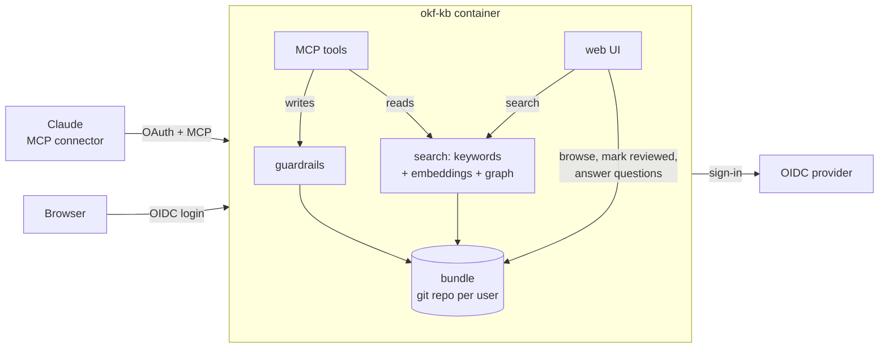

# okf-kb

**A self-hosted knowledge base that Claude keeps up to date for you.**

Your notes about servers, projects, decisions and past problems live in a private wiki of markdown
pages. Claude reads it before it answers and writes to it after it changes something, through an
**MCP server**. You browse, review and correct it in a small **web UI**. Every edit is a git commit.

[](LICENSE)


---

## Why

Chat assistants forget everything between sessions, and notes you keep by hand drift out of date.
okf-kb gives Claude one place to look things up and a duty to keep it current:

- **Ask first.** "Which version of X runs on the NAS?" is answered from your pages, with numbered
  citations, instead of a guess.
- **Write back.** After a config change, a fix or a decision, Claude edits the affected pages in
  place, so no page keeps stating the old value.
- **Stay correct.** Guardrails refuse bad writes: secrets, broken structure, and edits that wipe
  half a page. You confirm what's true in the web UI.

The pages follow Google's [Open Knowledge Format](https://github.com/GoogleCloudPlatform/open-knowledge-format)
(OKF v0.2), so they remain plain markdown files you can read, grep and keep without this server.

## Features

| | |
|---|---|
| **13 MCP tools** | read progressively (`kb_list` → `kb_read` → sections), answer with `kb_context`, write with `kb_write` / `kb_update`, plus move, delete, restore, history, ingest, verify and review |
| **Search that finds paraphrases** | keyword search with stemming and synonyms for exact facts, section embeddings for meaning, a relevance graph that pulls in related pages, and an optional reranker |
| **Git underneath** | one repository per user; every write is a commit with history, diffs and restore |
| **Guardrails on every write** | structure rules (portals → hubs → pages), required lead, title, description and tags, a size limit, duplicate titles, secret detection, and a refusal to silently shrink pages |
| **Change awareness** | after an edit, the server lists other pages that still state the removed value |
| **Trust model** | Claude's writes are marked `generated`; only you can mark a page human-reviewed |
| **Review queue** | Claude files questions it can't answer on the page; you answer them in the web UI and Claude works the answers in |
| **Web UI** | home dashboard, rendered pages, history with diffs, live search, an interactive link graph, `.tar.gz` export of your bundle |
| **Multi-user, private** | sign-in through any OIDC provider; each user gets their own bundle and nothing can be shared or published |
| **Runs offline** | the default embedding model is baked into the image; no runtime downloads |

## How it works



**[How it works in detail →](docs/how-it-works.md)**: diagrams of keyword search, embeddings, the
relevance graph and its hops, the `kb_context` pipeline, write checks, lint and gap analysis.

A **bundle** is a git repository of markdown pages with YAML frontmatter. The root holds only
**portals** (`infrastructure`, `projects`, …). Every other page sits under a portal or a **hub**,
which is a page with the same ID as its folder: `projects/garden` is the hub of
`projects/garden/irrigation`. Pages open with a 1–3 sentence lead, and hubs carry an `infobox` of key
facts. Each folder gets a generated `index.md`, and the root keeps a `log.md`.

## Quick start

```sh
git clone https://github.com/abishekvupputur/okf-kb.git && cd okf-kb
docker build -t okf-kb .
docker run -d --name kb -p 8000:8000 -v kb-data:/data --env-file kb.env okf-kb
```

Put it behind HTTPS (a reverse proxy or a tunnel), then in Claude go to
**Settings → Connectors → Add custom connector** and enter `<PUBLIC_URL>/mcp`.

### Configuration (`kb.env`)

| Variable | |
|---|---|
| `PUBLIC_URL` | Where the server is reached, e.g. `https://kb.example.com` |
| `OIDC_CONFIG_URL` | Your provider's `.well-known/openid-configuration` |
| `OIDC_CLIENT_ID`, `OIDC_CLIENT_SECRET` | A confidential OAuth2 client with redirect URIs `<PUBLIC_URL>/auth/callback` and `<PUBLIC_URL>/web/callback` |
| `JWT_SIGNING_KEY` | A random string; signs the tokens handed to MCP clients and the web session cookie |
| `STORAGE_ENCRYPTION_KEY` | A Fernet key that encrypts stored client registrations:<br/>`python -c "from cryptography.fernet import Fernet; print(Fernet.generate_key().decode())"` |

Optional:

| Variable | Default | |
|---|---|---|
| `KB_EMBED_MODEL` | `Qdrant/stella-en-400M-v5-doc-onnx` | Local model (MIT, ONNX, no PyTorch). Set `voyage-context-4` to use Voyage AI's contextualized embeddings instead (needs `VOYAGE_API_KEY`; page text is sent to Voyage) |
| `KB_RERANKER` | off | A FastEmbed cross-encoder, or a Voyage AI rerank model such as `rerank-3` (needs `VOYAGE_API_KEY`), which re-orders `kb_context`'s top pages |
| `KB_EMBED_THREADS` | `1` | CPU threads for embedding |
| `KB_SYNONYMS` | `sso oidc` | Search synonym groups: `;` between groups, spaces between words, e.g. `sso oidc;backup snapshot` |
| `KB_CHANGELOG_DAYS` | `90` | How long change-log sources are kept before pruning |

Your OIDC provider must return `sub` and `email`, and should issue refresh tokens for
`offline_access`, otherwise Claude's connector drops when the access token expires. okf-kb asks for
`offline_access` itself. **Everyone who can sign in gets a bundle**, so limit access at the provider.

## Using it

Once connected, Claude receives the server's instructions and follows them:

1. A question about your systems → `kb_context("…")` returns the relevant pages, numbered for citing.
2. A change is made → Claude finds every page stating the old value and updates them with `kb_update`.
3. A document worth keeping (release notes, a spec, a change log) → `kb_ingest` stores it unchanged
   under `sources/` and reports which pages it touches.
4. Anything only you can answer → it goes into the page's `review` field and shows up on the web home page.

Two prompts are included: `record_session` (write up what a session changed) and `ingest_source`.

## Data and backups

Everything lives in `/data`:

```
/data/bundles/<user>/   one git repository per user
/data/users.json        OIDC subject → bundle
/data/embeddings/       vectors (rebuildable)
/data/oauth/            encrypted client registrations
```

Back up `/data`. Each user can also download their bundle with its full git history from the web
UI (`/export.tar.gz`).

## Security

- Every page needs a sign-in, and each user only ever sees their own bundle. There is no sharing.
- Writes that look like they contain a secret (API tokens, private keys, JWTs, `PASSWORD=…`) are
  refused. Store the key's name and where it lives, not its value.
- The web UI sends a strict CSP (scripts from self only; sigma.js and graphology are vendored),
  checks the origin on POST requests (CSRF), and marks everything except `/static/` as
  `Cache-Control: private, no-store`, so a CDN never caches a private page or an export.
- The image runs as an unprivileged user, has pip and most base-image tools removed, and downloads nothing
  at runtime (the model is baked in at build time).

## Writing without the connector

`store.Bundle.save` commits without running the guardrails, so call `guard.check` first, as the tools do:

```sh
docker exec -i kb python - <<'EOF'
import sys; sys.path.insert(0, "/srv")
from app import guard, okf, store
b = store.Bundle(store.user_by_dir("<dir>"))
cid = "projects/garden"
meta, body = b.read(cid); old = body
body = body.replace("old fact", "new fact")
meta["generated"] = {"by": "claude/<model>", "at": okf.now_iso()}
print(guard.check(b, cid, meta, body, old_body=old))   # raises GuardError on a bad write
b.save(cid, meta, body, f"Update: [{meta['title']}](/{cid}.md)")
EOF
```

## Code map

| File | |
|---|---|
| `server.py` | entry point: FastMCP, OIDC proxy, server instructions |
| `tools.py` | the MCP tools |
| `web.py` | browser UI (middleware in front of FastMCP) |
| `store.py` | users, bundles, git |
| `okf.py` | OKF parsing and validation |
| `guard.py` | write rules, secret detection, lint |
| `search.py` | keyword search |
| `embed.py` | embeddings and reranking |
| `graph.py` | relevance graph |
| `render.py` | markdown → sanitized HTML |
| `prune.py` | expiry of old change logs |

## License

[MIT](LICENSE). The vendored [sigma.js](https://github.com/jacomyal/sigma.js) and
[graphology](https://github.com/graphology/graphology) in `app/static/vendor/` are MIT as well.
