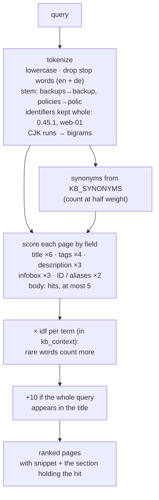
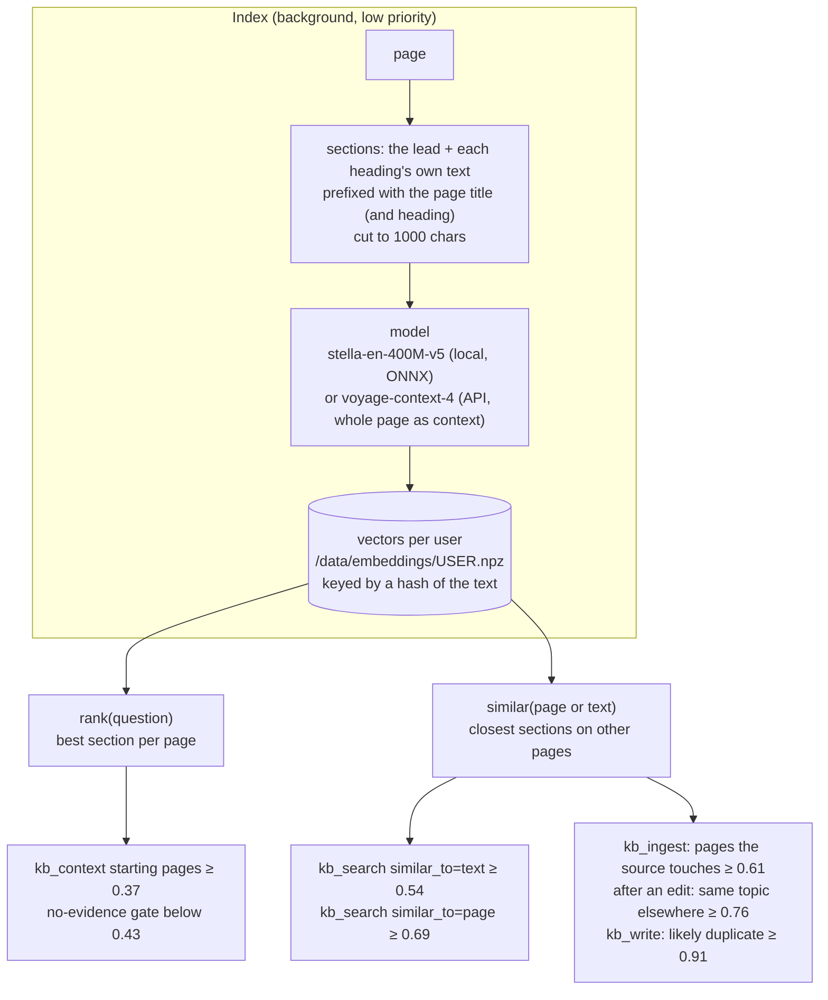
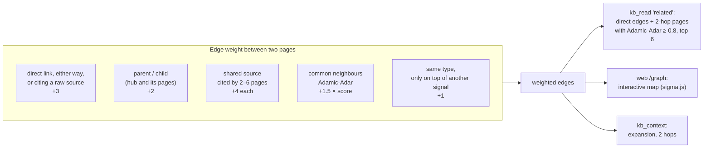
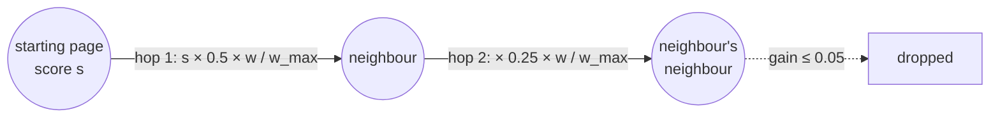
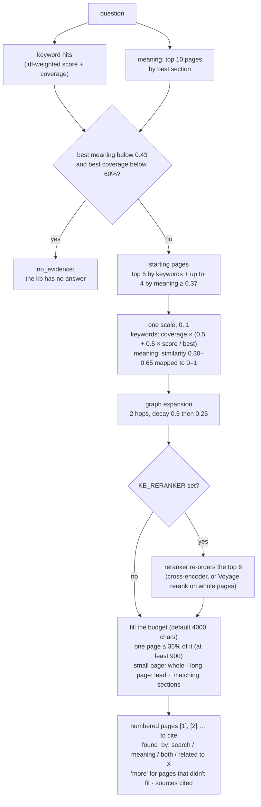
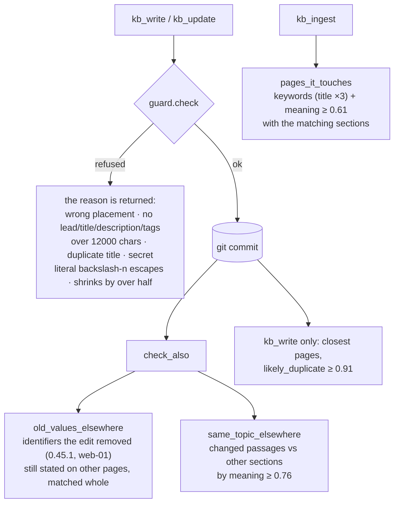
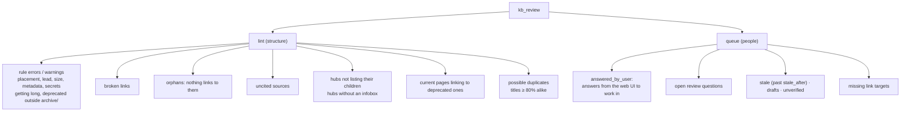
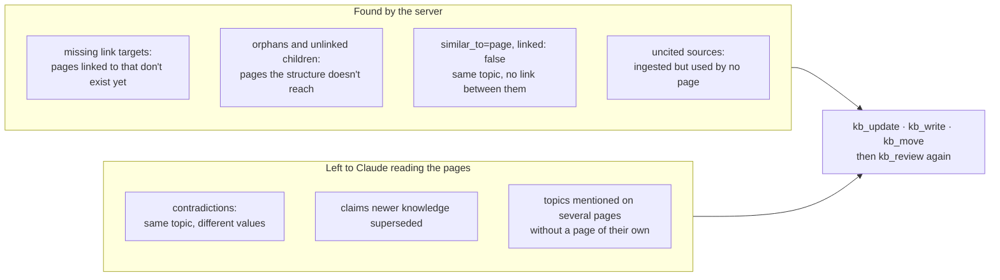

# How it works

What happens inside okf-wiki-mcp when Claude asks a question, writes a page or checks the bundle's
health. Each diagram matches the code it names. Thresholds are the defaults for the local model
(`stella-en-400M-v5`); `tools.py` holds the mapped values for `voyage-context-4`.

1. [Keyword search](#1-keyword-search-lexical): exact facts, values and names
2. [Embeddings](#2-embeddings-meaning): what is related by meaning
3. [Relevance graph](#3-relevance-graph): how pages connect, and hops
4. [kb_context](#4-kb_context-answering-a-question): answering a question with all three
5. [Maintenance](#5-maintenance-write-checks-lint-and-gaps): write checks, lint and gaps

---

## 1. Keyword search (lexical)

`search.py`, used by `kb_search(query=…)`, as one half of `kb_context`, and by `kb_ingest`.
Keywords stay in charge of **exact facts**: versions, IPs, hostnames and identifiers.

A term must **start a word**: `backup` finds *backups*, but `point` doesn't match inside
*endpoint*. `coverage()` measures the share of the question's idf weight a page contains (0–1), so a
page holding only one common word of the question doesn't look like an answer.

## 2. Embeddings (meaning)

`embed.py`. Embeddings find what is **about the same thing**, even with no words in common. They
only add relations; they never decide facts.

A write re-embeds only the sections whose text changed (with Voyage, the whole page, since every
section's vector depends on its page). After a restart nothing is re-embedded. If the model or the API
is unavailable, every caller falls back to keywords.

## 3. Relevance graph

`graph.py`. Pages are nodes, and an edge's weight adds up the signals that connect two pages
(after [nashsu/llm_wiki](https://github.com/nashsu/llm_wiki)).

A source cited everywhere says nothing about how two pages relate, so shared sources only count
when at most 6 pages cite them. **Hops** in `kb_context`:

A page reached from several starting pages keeps its **best** gain, not the sum, so a busy hub
can't climb above the pages that actually match.

## 4. kb_context: answering a question

`tools.py: kb_context`. This is the first tool for any question: keywords and meaning both pick
starting pages, the graph adds related ones, and the best pages fill a character budget.

With raw sources excluded (the default), `sources/` pages are only listed as citations to open
when a claim needs checking.

## 5. Maintenance: write checks, lint and gaps

Three layers keep the bundle healthy: **guardrails** refuse a bad write, **check-also hints** point
at what else the write made stale, and **`kb_review`** checks the whole bundle.

**Gap analysis**: finding what's missing, not what's wrong.

The checks are mechanical on purpose: similarity says two sections are about the same topic, not
that they agree, so deciding a contradiction always means reading both.
